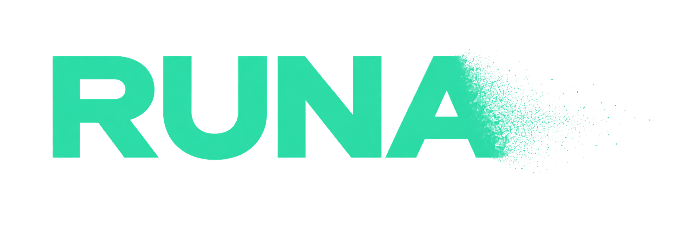

<div align="center">

<p align="center">
  
</p>

[](https://www.python.org/)
[](https://streamlit.io/)
[](https://scikit-learn.org/)
[](https://runa-ccifuentes.streamlit.app)

**Stellar characterisation from catalogue data**

[Open RUNA](https://runa-ccifuentes.streamlit.app) · [Portfolio](https://ccifuentesr.github.io/runa.html)

</div>

RUNA is a Python application that brings together astronomy utilities developed during my research on nearby cool stars. A selected object is the common input across the application, so catalogue data, visualisations and empirical estimates remain traceable to their source.

## Run locally

```bash
python3.12 -m venv .venv
source .venv/bin/activate
python -m pip install -r requirements.txt
streamlit run app.py
```

Open the local address shown in the terminal. Catalogue and image queries require an internet connection.

## Application areas

### Identification

Resolves a stellar name with SIMBAD and retrieves Gaia DR3, 2MASS and UCAC4 values when available. It displays catalogue identifiers, astrometry, radial velocity, a direct parallax distance, an SDSS DR17 cutout and a polar position view around the Sun.

### Photometry

Shows Gaia colour–magnitude context, retrieves GALEX, SDSS9, UCAC4, 2MASS, AllWISE and Gaia photometry, and converts available measurements into an observed SED. The results can be downloaded in a VOSA-compatible input format. It also provides an approximate G−J photometric distance using the Cifuentes et al. (2020) calibration, with its applicability warning.

#### Spectral-type estimation

Estimates an M-dwarf subtype from Gaia G and 2MASS J photometry with a quadratic colour model trained on selected M0–M5.5 stars. `train_model.py` reserves a stratified 20% test set and compares this two-band model with a random forest using G−J and J−W2. The deployed estimator keeps the two-band model because its inputs are inspectable and it works when W2 is unavailable. The result is a photometric estimate, not a replacement for spectroscopy.

### Parameters

**Status: In preparation.** Calculates absolute magnitudes and displays matched published bolometric luminosities from [Cifuentes et al. (2020)](https://doi.org/10.1051/0004-6361/202038295) and [Cifuentes et al. (2025)](https://ui.adsabs.harvard.edu/abs/2025A%26A...693A.228C/abstract). When applicable, it estimates mass from the main-sequence mass–luminosity relation of [Eker et al. (2018)](https://doi.org/10.1093/mnras/sty1834), without extrapolating outside its published intervals. It also includes an experimental Gaia/WISE photometric metallicity estimate based on [Duque-Arribas et al. (2023)](https://doi.org/10.3847/1538-4357/acacf6).

### Kinematics

**Status: Experimental.** Propagates Gaia coordinates to a requested epoch and prepares the inputs needed for BANYAN Σ young-association classification. Interpret membership probabilities alongside data quality and external evidence.

### Multiplicity

Applies the seven Gaia DR3 statistical indicators from Cifuentes et al. (2025, Table 3), visualises RVS score against RUWE, and retrieves nearby Gaia sources for visual inspection. These are indicators for follow-up, not a binary confirmation.

### Planets

Searches the [NASA Exoplanet Archive](https://exoplanetarchive.ipac.caltech.edu/) using the loaded star name and catalogue identifiers.

### Data

**Status: Reference.** Includes the published K5 V–L2.0 average parameters from Cifuentes et al. (2020, Table 6) as a browsable reference table.

## Project structure

```text
app.py                    Streamlit interface
identify_star.py          SIMBAD, Gaia, 2MASS, UCAC4 and SDSS retrieval
photometry.py             Catalogue photometry, CMD and SED tools
predict_star.py           Two-band spectral-type estimator
train_model.py            Reproducible model comparison
parameters.py             Magnitudes, luminosity, metallicity and mass relations
multiplicity.py           Gaia DR3 multiplicity indicators
kinematics.py             Coordinate propagation and BANYAN Σ inputs
light_curves.py           TESS light curves
planets.py                NASA Exoplanet Archive query
data/                     Published catalogues and filter data
```

## Sources

- [Cifuentes et al. (2020)](https://doi.org/10.1051/0004-6361/202038295) — nearby K and M dwarfs, photometric relations and Table 6 reference data.
- [Cifuentes et al. (2025)](https://ui.adsabs.harvard.edu/abs/2025A%26A...693A.228C/abstract) — updated CARMENES input catalogue and Gaia multiplicity criteria.
- [Eker et al. (2018)](https://doi.org/10.1093/mnras/sty1834) — main-sequence mass–luminosity relation.
- [Duque-Arribas et al. (2023)](https://doi.org/10.3847/1538-4357/acacf6) — Gaia/WISE photometric metallicity calibration.
- [SIMBAD](https://simbad.cds.unistra.fr/), [Gaia DR3](https://www.cosmos.esa.int/web/gaia/dr3), [VizieR](https://vizier.cds.unistra.fr/), [NASA Exoplanet Archive](https://exoplanetarchive.ipac.caltech.edu/) and [MAST](https://mast.stsci.edu/) — remote data services used by RUNA.

## Data and limits

The repository contains the runtime catalogues and filter data required by the application. Remote services can be unavailable, incomplete or return no counterpart. Missing values are presented as unavailable rather than imputed. RUNA is a research tool: inspect measurement quality, calibration range and method notes before interpreting an individual result.
